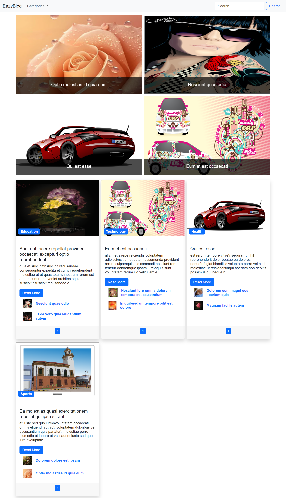

# Blog Project 2

A lightweight full-stack blog application built with Express.js, MongoDB, and Bootstrap. The app lets users browse posts, filter by category, search content, upload images, and manage content through an admin dashboard.

## Overview

This project is designed as a simple content management system for a blog website. It combines a server-side API with a front-end interface for publishing and managing posts, categories, and user profiles.

## Features

- Create, edit, and delete blog posts
- Browse posts by category or keyword
- Search content with text-based queries
- Display featured posts
- Upload and attach images in posts
- Register and log in users
- Protect admin-only pages and actions
- Persist blog data in MongoDB using Mongoose
- Serve a Bootstrap-based front-end experience

## Tech Stack

- Node.js
- Express.js
- MongoDB + Mongoose
- Express Session + connect-mongo
- Express Validator
- Multer
- Day.js
- Bootstrap, HTML, and JavaScript

## Project Structure

```text
Blog-Project-2/
├── app.js
├── .env
├── .gitignore
├── package.json
├── package-lock.json
├── README.md
├── config/
│   ├── database.js
│   ├── multer.js
│   └── cheerio.js
├── controllers/
│   ├── adminControllers.js
│   ├── authController.js
│   ├── miscControllers.js
│   ├── postControllers.js
│   └── userController.js
├── middleware/
│   └── authenticated.js
├── models/
│   ├── posts.js
│   └── user.js
├── protected/
│   └── admin pages and secure files
├── public/
│   ├── css/
│   ├── images/
│   ├── js/
│   └── HTML pages for the blog UI
├── routes/
│   ├── auth.js
│   ├── misc.js
│   ├── post.js
│   ├── settings.js
│   └── user.js
└── node_modules/
```

## Prerequisites

Before starting the app, ensure you have:

- Node.js installed
- MongoDB running locally or a valid MongoDB connection string

## Installation

1. Clone the repository:

```bash
git clone <repository-url>
cd Blog-Project-2
```

2. Install project dependencies:

```bash
npm install
```

3. Create a `.env` file in the project root:

```env
DATABASE=mongodb://localhost:27017/blog-project
SECRET=your_super_secret_session_key
```

> You can change the database URI and session secret to match your local setup.

## Run the Application

Start the server:

```bash
npm start
```

For development with automatic restarts:

```bash
npm run dev
```

The app will run at:

```text
http://localhost:3000
```

## API Overview

### Public Blog Endpoints

- `GET /api/posts` — Fetch posts grouped by category
- `GET /api/all-posts` — Fetch all posts with pagination
- `GET /api/categories` — Get all distinct categories
- `GET /api/posts/:title` — Fetch a single post by title
- `GET /api/search` — Search posts by keyword or phrase
- `GET /api/posts/category` — Filter posts by category or keyword
- `GET /api/posts/featured` — Fetch featured posts

### Protected/Admin Endpoints

- `POST /api/posts/add` — Add a new post
- `POST /api/posts/edit` — Update an existing post
- `DELETE /api/post/delete/:id` — Delete a post
- `GET /api/check-auth` — Check whether the current user is logged in
- `GET /api/check-user` — Get the authenticated user profile
- `POST /api/verify-password` — Verify a password before updating profile data
- `POST /api/logout` — Log the current user out

### User Auth Endpoints

- `POST /api/register` — Register a new user
- `POST /api/login` — Authenticate a user

### Utility Endpoints

- `GET /flash` — Read session flash messages
- `POST /upload` — Upload an image and return its URL

## Authentication

The application uses session-based authentication with `express-session` and `connect-mongo`. Protected routes are enforced by middleware in `middleware/authenticated.js`, which checks for an authenticated session before allowing access to sensitive admin pages.

## Environment Notes

The app depends on a valid MongoDB connection string and a secret session key from the environment. If `DATABASE` is missing or the database is unavailable, the app will not work as expected.

## Demo / Preview

Once the app is running locally, open the following URL in your browser:

```text
http://localhost:3000
```

You can use the public blog pages to browse posts and categories, and the secured admin section to create and manage content after logging in.

### Example Preview



You can add more screenshots in `public/images/` and reference them the same way.

## Notes

- The project does not include a dedicated automated test suite.
- Static front-end pages are served from the `public` directory.
- Protected/admin pages are served from the `protected` directory.
- Uploaded image files are stored in the public image area and are tracked during post creation and deletion.

## License

This project is licensed under the MIT License.
